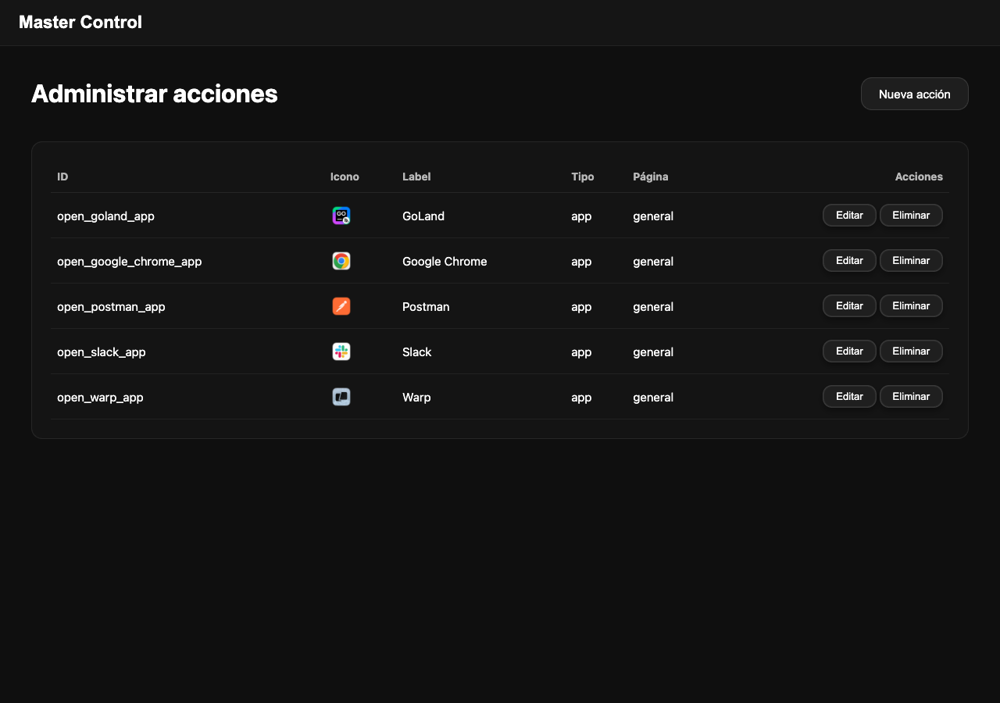
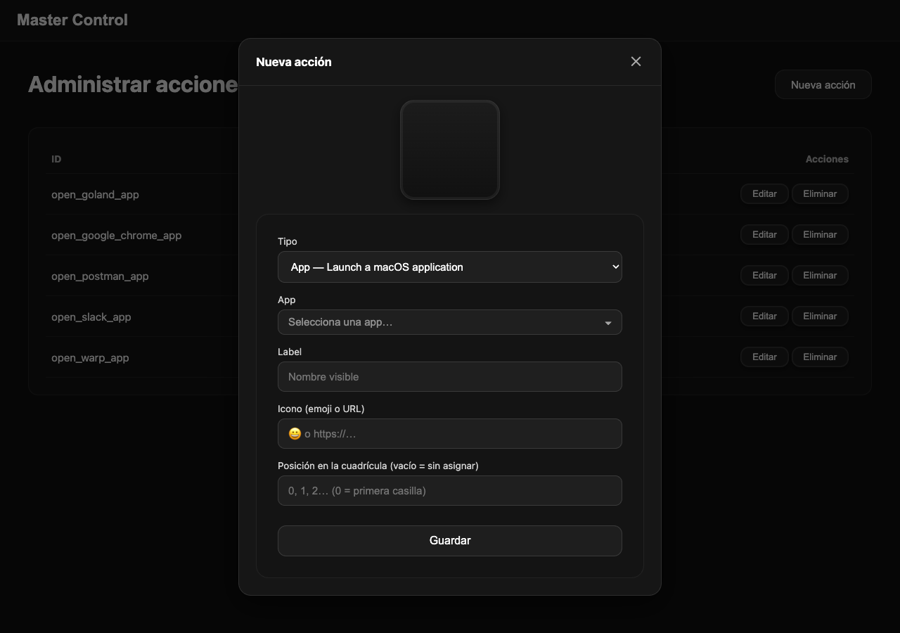
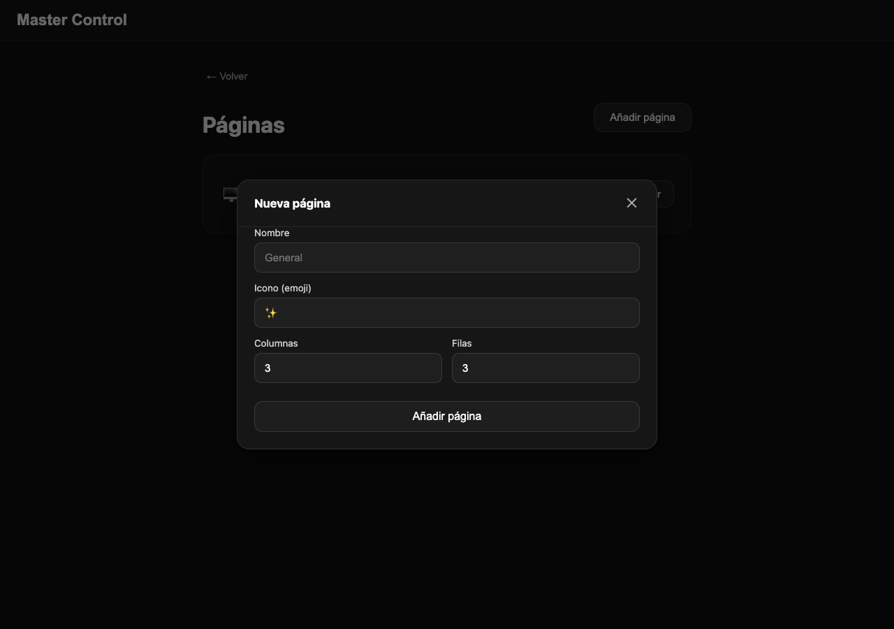

# Master Control

Panel para controlar tu Mac desde el navegador: dispara acciones, hotkeys y aplicaciones del equipo sin tocar el teclado. Monorepo con backend en Go y frontend en SvelteKit.

## Características

- **Acciones** sobre el Mac: comandos de shell y AppleScript (p. ej. `open -a "Visual Studio Code"`, simular teclas con `System Events`).
- **Captura de hotkeys** real desde el navegador: el backend escucha una tecla física (hasta 15 s) y devuelve keycode + modificadores.
- **Páginas** para organizar y agrupar las acciones en la UI.
- **Explorador de apps**: lista las aplicaciones instaladas en `/Applications` y sirve sus iconos.
- **Tipos de acción** (`action-types`) manejables vía API y sembrados al arrancar.
- **Persistencia** en bbolt (base de datos embebida, un solo archivo).
- **Acceso protegido**: token obligatorio (`MC_TOKEN`) en toda la API, escucha solo en `127.0.0.1` por defecto y CORS limitado a la UI.
- **Salida de comandos**: cada ejecución devuelve `stdout`, `stderr`, exit code y duración; la UI muestra un aviso o la salida completa.
- **Por acción**: pedir confirmación antes de ejecutar, mostrar siempre la salida y timeout propio (acotado por `MC_MAX_TIMEOUT`).

## Capturas

### Panel principal

Panel que agrupa las apps y acciones en una cuadrícula por página.


### Gestión de acciones

Administra las acciones del Mac (abrir apps, ejecutar comandos o AppleScript, hotkeys).



### Nueva acción

Crea una acción desde un modal eligiendo su tipo (app, AppleScript, comando, hotkey o acción del sistema) y configuración.



### Páginas

Crea y organiza páginas que agrupan tus acciones en la UI.


### Nueva página

Añade una página desde un modal definiendo nombre, icono y tamaño de la cuadrícula.



## Estructura

```
.
├── backend/                    # API en Go (Gin + bbolt)
│   ├── bootstrap/              # Wiring: arranque, logger, bbolt, rutas
│   ├── domain/                 # Casos de uso (action, page, actiontype)
│   ├── infrastructure/         # Handlers HTTP, repos, captura de hotkeys (cgo)
│   ├── model/                  # Structs y contratos compartidos
│   ├── main.go
│   └── api.http                # Requests de ejemplo (VS Code REST Client)
├── frontend/                   # UI en SvelteKit 5 + Vite + TypeScript (pnpm)
│   └── src/
│       ├── lib/api/            # Cliente API (un archivo por recurso)
│       ├── lib/components/     # ActionButton, HotkeyRecorder, ...
│       └── routes/             # /actions, /pages, ...
├── screenshots/                # Capturas de la UI para el README
└── dev.sh                      # Levanta backend + frontend juntos
```

Arquitectura en capas: `bootstrap/` inyecta los casos de uso (`domain/`) a los handlers y repositorios (`infrastructure/`). Los repos persisten JSON en buckets de bbolt; `action-types` y `pages` se siembran al iniciar.

## Requisitos

- **macOS** (las acciones y la captura de hotkeys usan funcionalidad nativa: `osascript` → System Events, y cgo/Carbon).
- **Go 1.25+**
- **Node.js** y **pnpm**

## Puesta en marcha

Levanta ambos servicios desde la raíz:

```sh
./dev.sh               # solo esta Mac (127.0.0.1) — por defecto
./dev.sh --tailscale   # tu tailnet: iPad/iPhone con Tailscale, tráfico cifrado (recomendado)
./dev.sh --lan         # la red local: HTTP sin cifrar, el token viaja en claro por el WiFi
```

`./dev.sh` crea `backend/.env` si falta, genera un `MC_TOKEN` persistente la primera vez y
arranca `go run .` (backend) y `pnpm dev` (frontend) en la interfaz del modo elegido, con CORS
limitado a esa UI. Imprime la URL de acceso con el token en el fragmento
(`http://<host>:5173/#token=…`) y, si tienes `qrencode` (`brew install qrencode`), un QR para
escanearla desde la tablet. Ábrela **una vez por dispositivo**: el token queda guardado en el
navegador y se quita de la barra de direcciones. Sin él, la UI pide pegar el `MC_TOKEN`.

### Usarlo desde el iPad o el iPhone (Tailscale)

1. Instala Tailscale en la Mac y en el iPad/iPhone e inicia sesión con la misma cuenta.
2. `./dev.sh --tailscale` y escanea el QR (o abre la URL) en el dispositivo.
3. Opcional: «Compartir → Añadir a pantalla de inicio» para abrirlo como app.

Así el panel solo es accesible desde tus dispositivos y nunca desde el WiFi de la oficina o un café.

### Atajos de Siri y Apple Watch

Cualquier acción se puede disparar sin abrir la UI: en la app Atajos, «Obtener contenido de URL»
con método `POST` a `http://<IP-tailscale>:8080/master-control/actions/<id>/execute` y la cabecera
`Authorization: Bearer <MC_TOKEN>`. Ponle un nombre y se ejecuta con «Oye Siri, <nombre>» o desde
la Watch. La respuesta es JSON (`ok`, `stdout`, …) por si quieres que Siri lea la salida.

### Backend

```sh
cd backend
go run .
```

Servidor en `http://127.0.0.1:8080/master-control`. Configuración vía `backend/.env` (gitignored; plantilla en `backend/.env.example`). Las variables exportadas en el entorno ganan sobre `.env` (así las fija `./dev.sh`).

| Variable    | Uso                                            |
|-------------|------------------------------------------------|
| `GIN_MODE`  | Modo de Gin (`debug` / `release`)              |
| `APP_NAME`  | Prefijo de ruta de la API; usa `master-control` |
| `BUCKET_NAME` | Reservado (los buckets de bbolt están definidos en el código) |
| `MC_TOKEN`  | Token obligatorio de la API (salvo `/health`). Vacío = uno efímero por ejecución, impreso en el log |
| `MC_HOST`   | Interfaz en la que escucha (default `127.0.0.1`) |
| `MC_PORT`   | Puerto (default `8080`)                         |
| `MC_ALLOWED_ORIGINS` | Orígenes de la UI permitidos por CORS, separados por coma. Vacío = todos (con token igualmente) |
| `MC_MAX_TIMEOUT` | Tope en segundos del `timeout_seconds` de cualquier acción (default `120`) |

> Si `APP_NAME` queda vacío, la API se sirve en `/` en vez de `/master-control`.

### Frontend

```sh
cd frontend
pnpm install
pnpm dev            # solo local (localhost)
```

La UI apunta a la API en `http://<host>:8080/master-control` (definido en `frontend/src/lib/api/api.ts`; sin proxy de Vite). Todas las peticiones pasan por `apiFetch`, que añade el token; los iconos (``) lo llevan en `?token=` vía `authUrl`, solo al mostrarse (nunca se guarda en la acción). Para otros dispositivos usa `./dev.sh --tailscale`.

## API

Prefijo base: `/master-control` · Auth: `Authorization: Bearer <MC_TOKEN>` (o `?token=` para imágenes) en todo salvo `/health` · CORS: `MC_ALLOWED_ORIGINS` · BBDD: bbolt (`bbolt.db`)

| Método | Ruta                          | Descripción                              |
|--------|-------------------------------|------------------------------------------|
| GET    | `/health`                     | Health check                             |
| GET    | `/actions`                    | Lista acciones                           |
| GET    | `/actions/:id`                | Acción por ID                            |
| POST   | `/actions`                    | Crea acción                              |
| PUT    | `/actions/:id`                | Actualiza acción                         |
| DELETE | `/actions/:id`                | Elimina acción                           |
| POST   | `/actions/:id/execute`        | Ejecuta la acción y devuelve `{ok, exit_code, stdout, stderr, duration_ms, timed_out, truncated}` (un exit code ≠ 0 es `200` con `ok:false`) |
| GET    | `/action-types`               | Lista tipos de acción (seed al arrancar) |
| GET/POST/PUT/DELETE | `/action-types[/:id]` | CRUD de tipos de acción                  |
| GET    | `/pages`                      | Lista páginas                            |
| GET/POST/PUT/DELETE | `/pages[/:id]`      | CRUD de páginas                          |
| GET    | `/apps`                       | Apps instaladas en `/Applications`       |
| GET    | `/apps/:name/icon`            | Icono de una app                         |
| GET    | `/apps/icon?path=...`         | Icono por ruta                           |
| POST   | `/hotkey/capture`             | Espera una tecla (≤15 s) y devuelve hotkey |

## Notas para macOS

- `POST /hotkey/capture` **bloquea hasta 15 s** esperando una tecla y requiere que el terminal/backend tenga el permiso de **Accesibilidad** del sistema.
- Las acciones AppleScript que simulan teclas usan `osascript` → **System Events** (requieren Accesibilidad).
- La lista e iconos de apps escanean `/Applications` y generan iconos con `sips`.
- El paquete `infrastructure/hotkey` usa **cgo** (Carbon/ApplicationServices, `//go:build darwin`); en otras plataformas devuelve `ErrNotSupported`.

## Campos de una acción

| Campo | Uso |
|-------|-----|
| `id`, `label`, `icon`, `type`, `command`, `page`, `position` | Como antes |
| `confirm` | La UI pide confirmación (mostrando el comando) antes de ejecutar; el botón lleva 🔒 |
| `show_output` | La UI abre la salida al terminar. Un fallo o timeout la abre siempre; si no, solo un aviso breve |
| `timeout_seconds` | Timeout propio (vacío = 10 s), recortado a `MC_MAX_TIMEOUT` |

La salida se recorta a 16 KB por stream (`truncated: true`).

## Verificación

```sh
cd backend && go build ./... && go vet ./... && go test ./...
cd frontend && pnpm check && pnpm build
```

```sh
# Backend
cd backend && go build ./... && go vet ./...

# Frontend
cd frontend && pnpm check        # svelte-check
cd frontend && pnpm build        # vite build
```