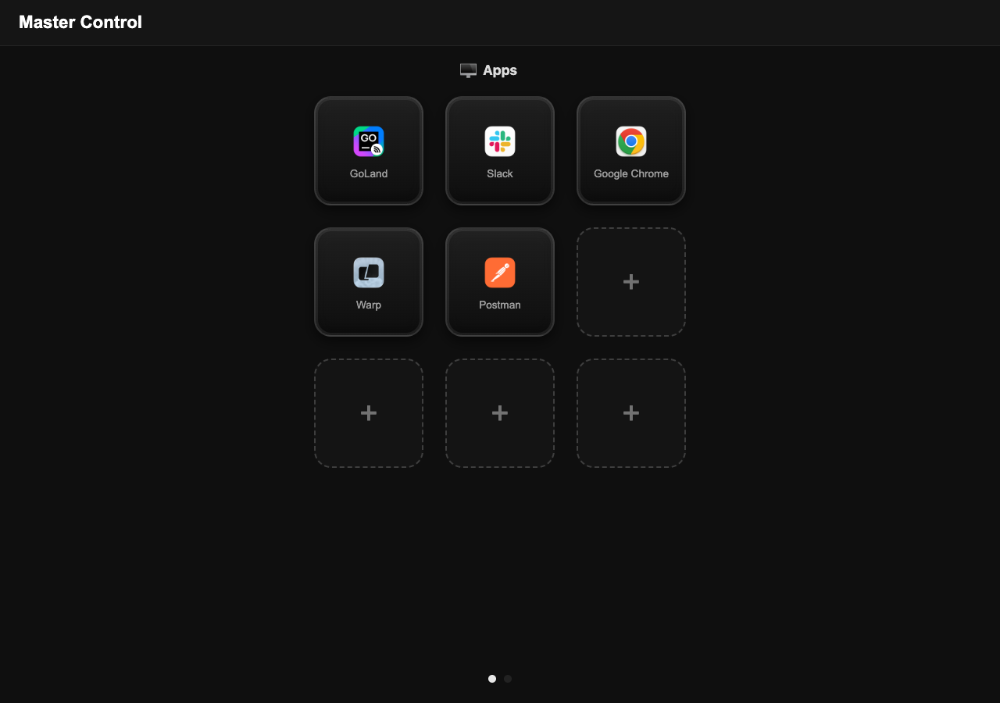
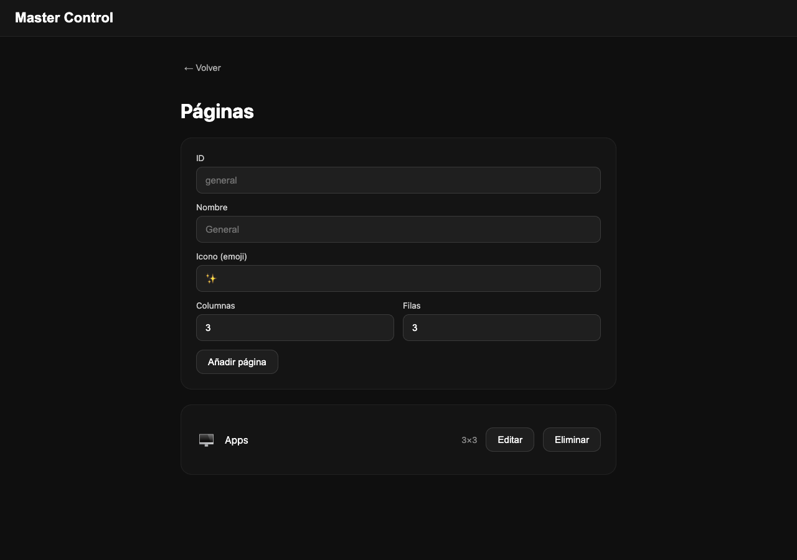

# Master Control

Panel para controlar tu Mac desde el navegador: dispara acciones, hotkeys y aplicaciones del equipo sin tocar el teclado. Monorepo con backend en Go y frontend en SvelteKit.

## Características

- **Acciones** sobre el Mac: comandos de shell y AppleScript (p. ej. `open -a "Visual Studio Code"`, simular teclas con `System Events`).
- **Captura de hotkeys** real desde el navegador: el backend escucha una tecla física (hasta 15 s) y devuelve keycode + modificadores.
- **Páginas** para organizar y agrupar las acciones en la UI.
- **Explorador de apps**: lista las aplicaciones instaladas en `/Applications` y sirve sus iconos.
- **Tipos de acción** (`action-types`) manejables vía API y sembrados al arrancar.
- **Persistencia** en bbolt (base de datos embebida, un solo archivo).

## Capturas

### Panel principal

Panel que agrupa las apps y acciones en una cuadrícula por página.



### Gestión de acciones

Administra las acciones del Mac (abrir apps, ejecutar comandos o AppleScript, hotkeys).


### Nueva acción

Crea una acción desde un modal eligiendo su tipo (app, AppleScript, comando, hotkey o acción del sistema) y configuración.


### Páginas

Crea y organiza páginas que agrupan tus acciones en la UI.



### Nueva página

Añade una página desde un modal definiendo nombre, icono y tamaño de la cuadrícula.


## Estructura

```
.
├── backend/                    # API en Go (Gin + bbolt)
│   ├── bootstrap/              # Wiring: arranque, logger, bbolt, rutas
│   ├── domain/                 # Casos de uso (action, page, actiontype)
│   ├── infrastructure/         # Handlers HTTP, repos, captura de hotkeys (cgo)
│   ├── model/                  # Structs y contratos compartidos
│   ├── main.go
│   └── api.http                # Requests de ejemplo (VS Code REST Client)
├── frontend/                   # UI en SvelteKit 5 + Vite + TypeScript (pnpm)
│   └── src/
│       ├── lib/api/            # Cliente API (un archivo por recurso)
│       ├── lib/components/     # ActionButton, HotkeyRecorder, ...
│       └── routes/             # /actions, /pages, ...
├── screenshots/                # Capturas de la UI para el README
└── dev.sh                      # Levanta backend + frontend juntos
```

Arquitectura en capas: `bootstrap/` inyecta los casos de uso (`domain/`) a los handlers y repositorios (`infrastructure/`). Los repos persisten JSON en buckets de bbolt; `action-types` y `pages` se siembran al iniciar.

## Requisitos

- **macOS** (las acciones y la captura de hotkeys usan funcionalidad nativa: `osascript` → System Events, y cgo/Carbon).
- **Go 1.25+**
- **Node.js** y **pnpm**

## Puesta en marcha

Levanta ambos servicios desde la raíz:

```sh
./dev.sh
```

Equivale a correr `go run .` en `backend/` y `pnpm dev --host` en `frontend/`. El script detecta la IP local de tu Mac y muestra las URLs para conectarte desde una tablet o celular en la misma red (UI y API).

### Backend

```sh
cd backend
go run .
```

Servidor en `http://localhost:8080/master-control`. Configuración vía `backend/.env` (ver `backend/.gitignore`):

| Variable    | Uso                                            |
|-------------|------------------------------------------------|
| `GIN_MODE`  | Modo de Gin (`debug` / `release`)              |
| `APP_NAME`  | Prefijo de ruta de la API; usa `master-control` |

> Si `APP_NAME` queda vacío, la API se sirve en `/` en vez de `/master-control`.

### Frontend

```sh
cd frontend
pnpm install
pnpm dev            # solo local (localhost)
pnpm dev --host     # accesible desde otros dispositivos de la red
```

La UI apunta a la API en `http://<host>:8080/master-control` (definido en `frontend/src/lib/api/api.ts`; sin proxy de Vite, el backend responde CORS para todos los orígenes). Para usar la app desde una tablet/celular entra a `http://<IP-del-Mac>:5173`; la IP la muestra `./dev.sh`.

## API

Prefijo base: `/master-control` · CORS abierto · BBDD: bbolt (`bbolt.db`)

| Método | Ruta                          | Descripción                              |
|--------|-------------------------------|------------------------------------------|
| GET    | `/health`                     | Health check                             |
| GET    | `/actions`                    | Lista acciones                           |
| GET    | `/actions/:id`                | Acción por ID                            |
| POST   | `/actions`                    | Crea acción                              |
| PUT    | `/actions/:id`                | Actualiza acción                         |
| DELETE | `/actions/:id`                | Elimina acción                           |
| POST   | `/actions/:id/execute`        | Ejecuta la acción en el Mac              |
| GET    | `/action-types`               | Lista tipos de acción (seed al arrancar) |
| GET/POST/PUT/DELETE | `/action-types[/:id]` | CRUD de tipos de acción                  |
| GET    | `/pages`                      | Lista páginas                            |
| GET/POST/PUT/DELETE | `/pages[/:id]`      | CRUD de páginas                          |
| GET    | `/apps`                       | Apps instaladas en `/Applications`       |
| GET    | `/apps/:name/icon`            | Icono de una app                         |
| GET    | `/apps/icon?path=...`         | Icono por ruta                           |
| POST   | `/hotkey/capture`             | Espera una tecla (≤15 s) y devuelve hotkey |

## Notas para macOS

- `POST /hotkey/capture` **bloquea hasta 15 s** esperando una tecla y requiere que el terminal/backend tenga el permiso de **Accesibilidad** del sistema.
- Las acciones AppleScript que simulan teclas usan `osascript` → **System Events** (requieren Accesibilidad).
- La lista e iconos de apps escanean `/Applications` y generan iconos con `sips`.
- El paquete `infrastructure/hotkey` usa **cgo** (Carbon/ApplicationServices, `//go:build darwin`); en otras plataformas devuelve `ErrNotSupported`.

## Verificación

No hay tests ni linters configurados.

```sh
# Backend
cd backend && go build ./... && go vet ./...

# Frontend
cd frontend && pnpm check        # svelte-check
cd frontend && pnpm build        # vite build
```